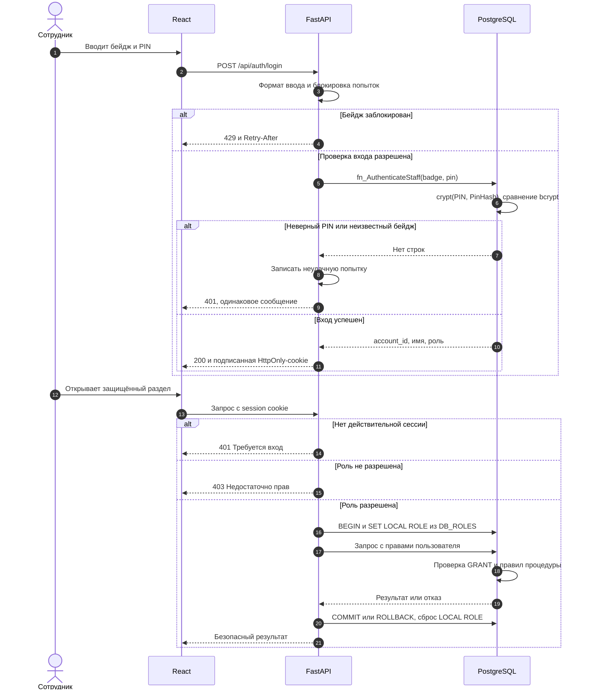
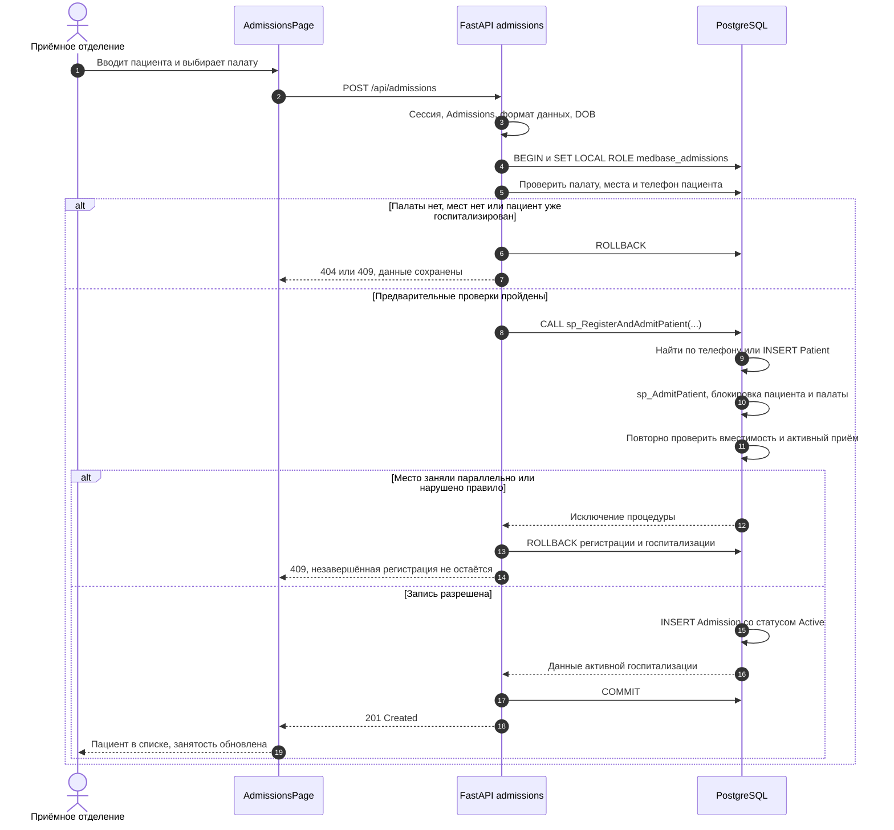
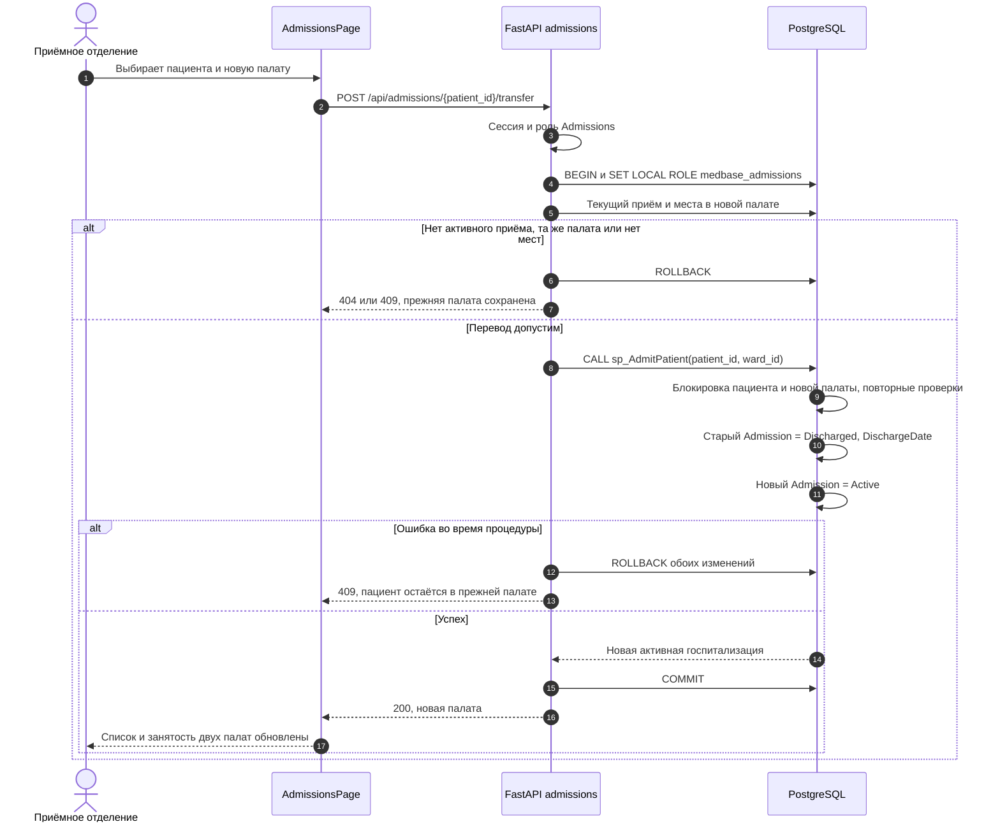
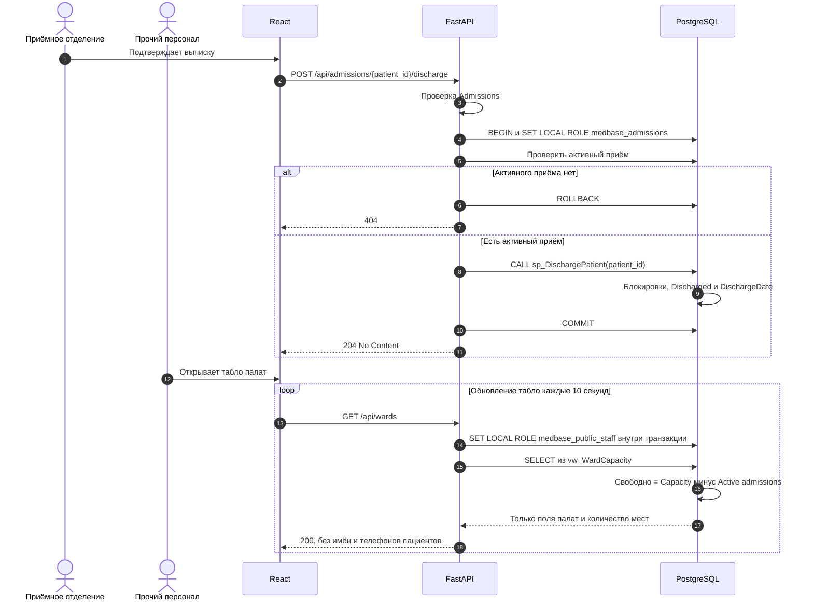
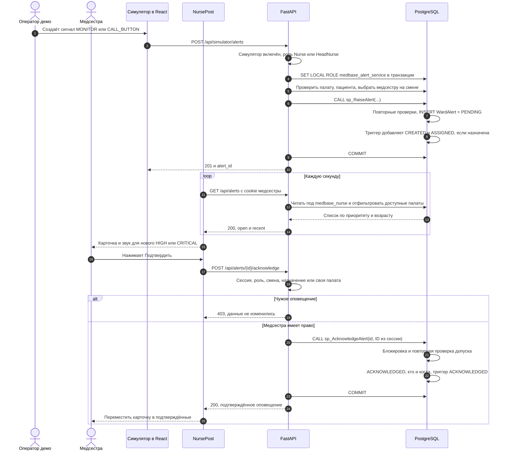
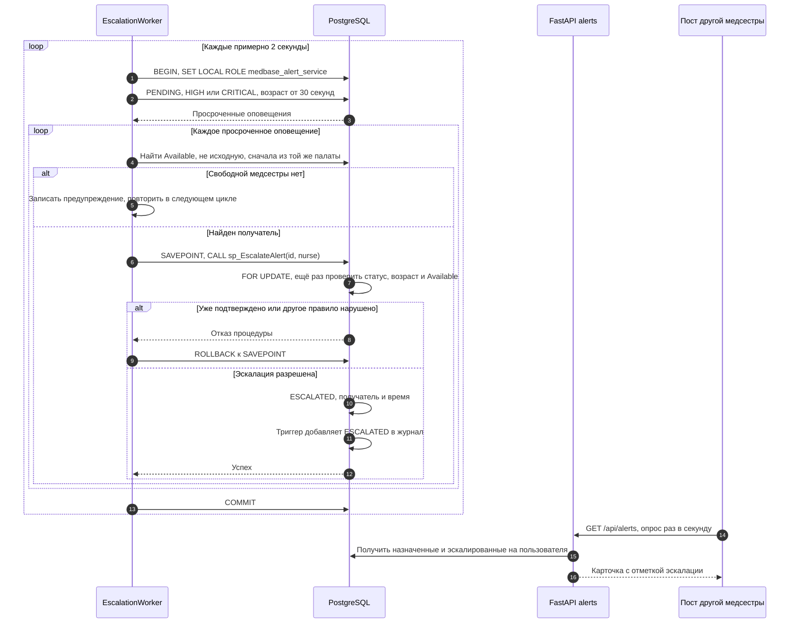

# Sequence diagrams: что делает Hospital Ward Management

Автор: Shynbulat Kazbek (24B032123, Kazbekio), Architecture & Security.

Срез: `main` от 12 ноября 2026, базовый коммит `a8ffc3f` (UC-1 — UC-7).

Каждая вертикальная линия — участник процесса. Стрелки читаются сверху вниз:
вызов → проверка → изменение данных → ответ. `alt` показывает варианты,
`loop` — повторение. nginx передаёт `/api` в FastAPI без изменения бизнес-логики;
он опущен на диаграммах ради читаемости. SQL-процедуры показаны внутри БД.

Открыть диаграммы можно прямо на GitHub. В VS Code открыть Markdown Preview
(`Ctrl+Shift+V`); если установленная версия preview не рисует Mermaid, показать
этот файл на GitHub. Исходный текст диаграмм хранится вместе с кодом и
обновляется при изменении сценария.

## 1. Вход и разрешение на действие

Реализовано: `backend/app/routers/auth.py`, `auth.py`, `db.py`,
`db/02_procedures.sql`, `db/03_security.sql`.

**Что доказываем:** личность проверяется при входе; роль — при каждом
защищённом действии. Подписанная cookie защищает целостность, но не шифрует
содержимое. `HttpOnly` закрывает доступ из JavaScript страницы; владелец
браузера всё ещё может посмотреть свою cookie в инструментах разработчика.

## 2. Регистрация и госпитализация пациента (UC-1)

Реализовано: `backend/app/routers/admissions.py`, `db/02_procedures.sql`.
Требования FR-01 — FR-04.

**Что доказываем:** новый пациент и его госпитализация сохраняются одной
транзакцией. Проверка свободных мест повторяется после блокировки строки,
чтобы два запроса не заняли последнюю койку одновременно.

## 3. Перевод в другую палату (UC-2)

Реализовано: `admissions.transfer`, `sp_AdmitPatient`. FR-05 — FR-07.

**Что доказываем:** перевод сохраняет историю. Он не меняет номер палаты в
старой записи, а закрывает старую госпитализацию и создаёт новую атомарно.

## 4. Выписка и табло занятости (UC-3, UC-4)

Реализовано: `admissions.discharge`, `wards.list_wards`,
`sp_DischargePatient`, `vw_WardCapacity`. FR-08 — FR-13, NFR-03.

**Что доказываем:** выписанный пациент остаётся в истории, но освобождает
место. Табло считает только активные госпитализации и не раскрывает пациентов.

## 5. Вызов медсестры и подтверждение (UC-5, UC-6)

Реализовано: `routers/simulator.py`, `routers/alerts.py`, `SimulatorPage.tsx`,
`NursePost.tsx`, `sp_RaiseAlert`, `sp_AcknowledgeAlert` и триггер журнала.
FR-14 — FR-22; целевое время показа NFR-01 — не более 2 секунд.

**Что доказываем:** в текущем MVP сигнал создаёт симулятор. Реальные мониторы
и доставка на физические устройства не подключены. Пост использует HTTP-опрос
раз в секунду; SSE здесь пока нет. Сам интервал опроса не доказывает NFR-01:
время до отрисовки и звука нужно отдельно измерять браузерным e2e-тестом.

## 6. Эскалация неподтверждённого сигнала (UC-7)

Реализовано: `backend/app/escalation.py`, `sp_EscalateAlert`.
FR-24 — FR-27; NFR-02 задаёт 30 секунд и допуск до 35 секунд при проверке.

**Что доказываем:** LOW не эскалируется. Повторная проверка под блокировкой
защищает от гонки между подтверждением и эскалацией. Если нет Available,
доставку в пределах 35 секунд гарантировать нельзя: система повторяет поиск.

## 7. Связь диаграмм с проверками и направлением разработки

| Сценарий | Существующие проверки | Новый вклад Architecture & Security |
|---|---|---|
| Вход и права | `tests/test_auth.py` | Матрица реальных API: Anonymous и все 4 роли |
| UC-1 — UC-3 | `tests/test_admissions.py`, SQL-тесты процедур | Запрет чтения, госпитализации, перевода и выписки чужим ролям; отсутствие изменений при отказе |
| UC-4 | `tests/test_admissions.py` | Точный список полей табло без персональных данных |
| UC-5, UC-6 | `tests/test_alerts.py` | Доступ к симулятору и посту; чужая палата; выключенный симулятор |
| UC-7 | `tests/test_alerts.py`, SQL-тесты | Схема worker и повторных проверок; непрерывная безопасность ролей пула |
| UC-8 | В `main` пока отсутствует | Отчёт старшей медсестры находится в PR #12; API отчёта здесь не заявлен проверенным |

Реализация движется к согласованным двум процессам: UC-1 — UC-7 уже связаны
API и UI, UC-8 находится в отдельной разработке. Диаграммы помогают проверить,
что новый код сохраняет транзакции, историю и оба слоя контроля доступа.
Зелёные тесты прав подтверждают этот аспект, но не заменяют приёмку всех
сценариев, измерение задержек, тест звука и полную проверку безопасности.

Отчёт по новой проверке: [testing/api-permissions-report.md](testing/api-permissions-report.md).
