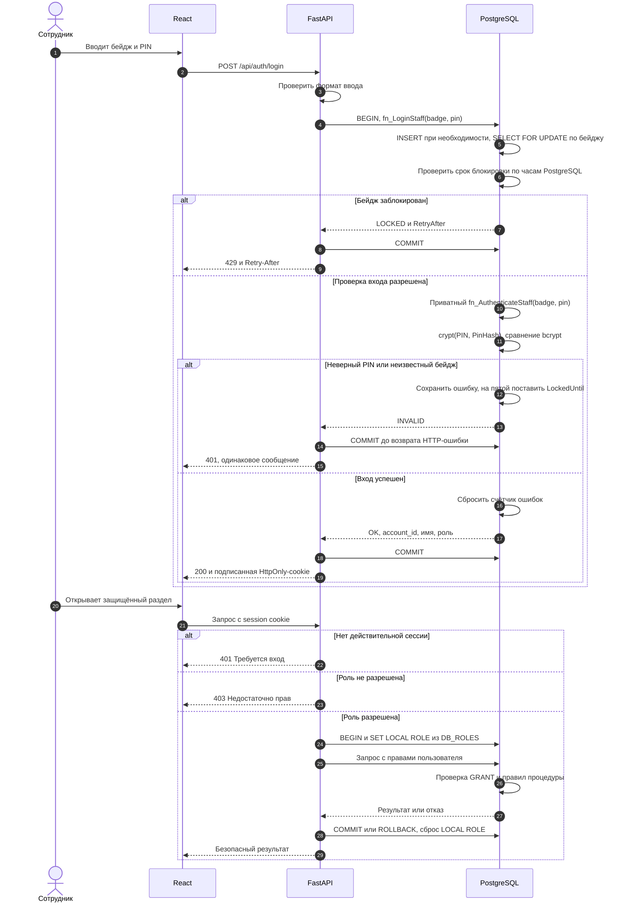
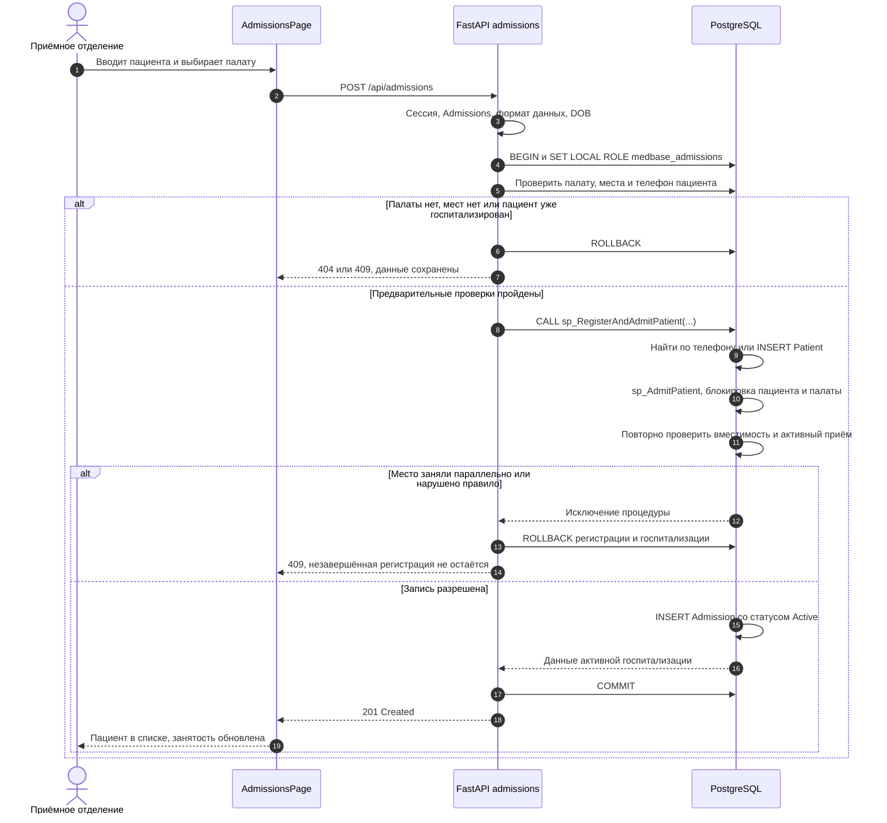
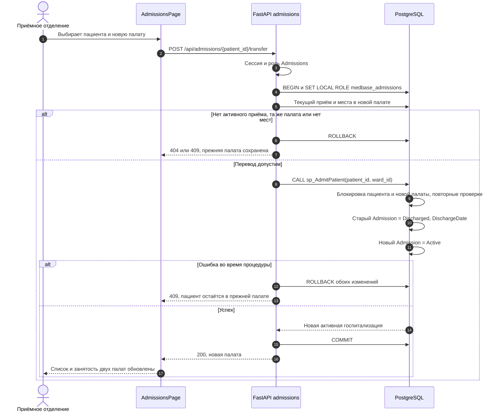
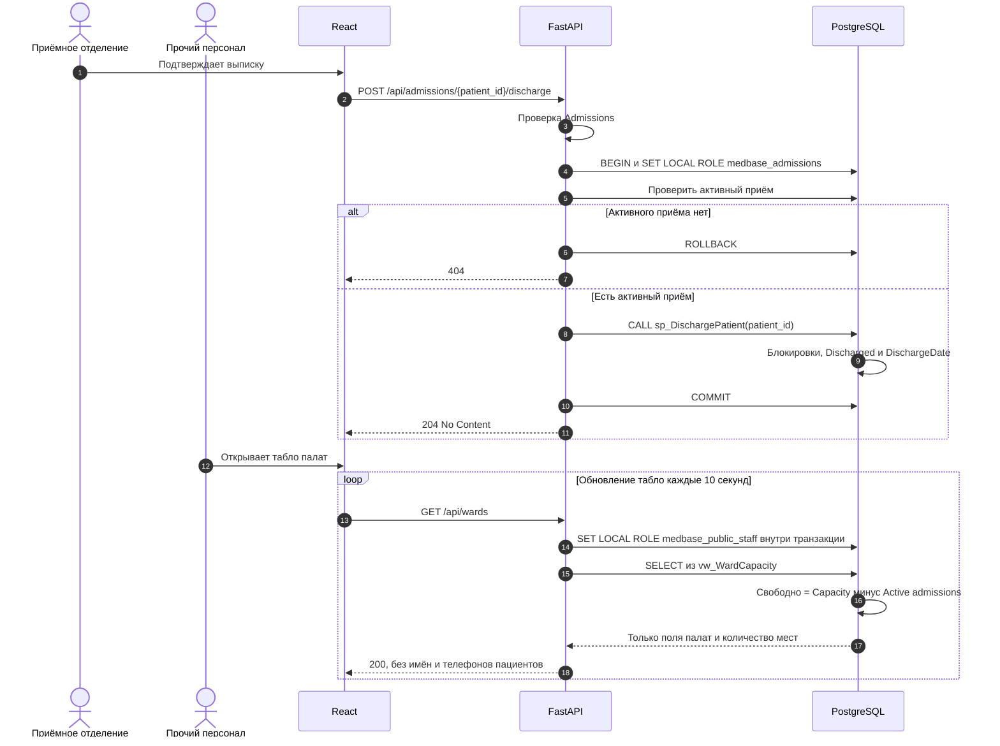
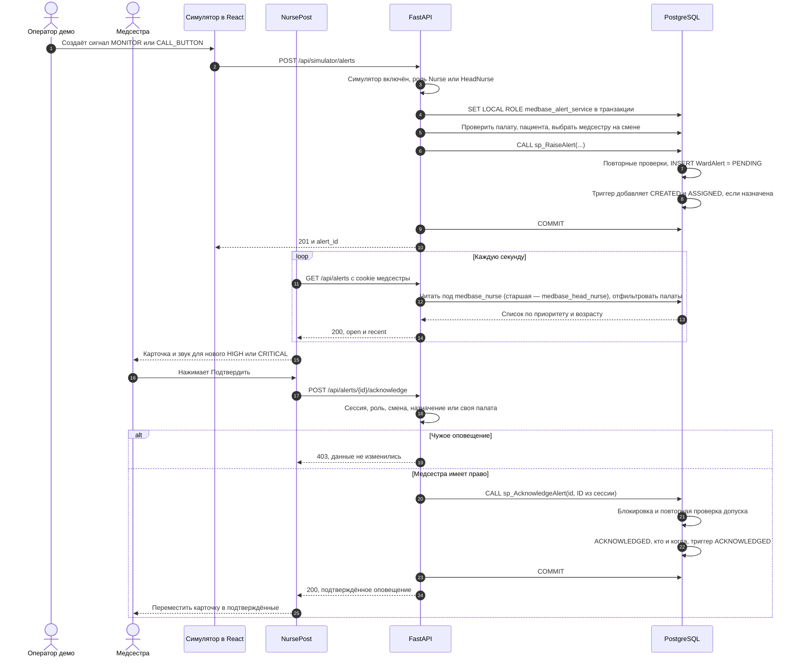
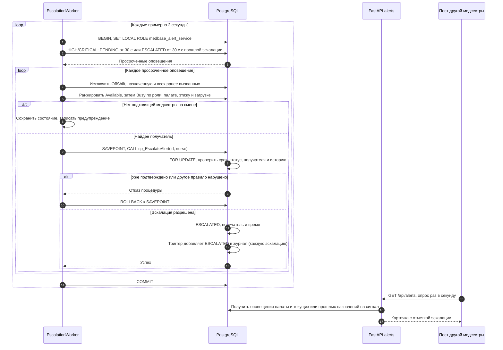
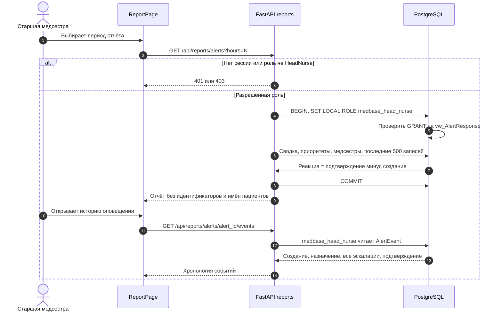
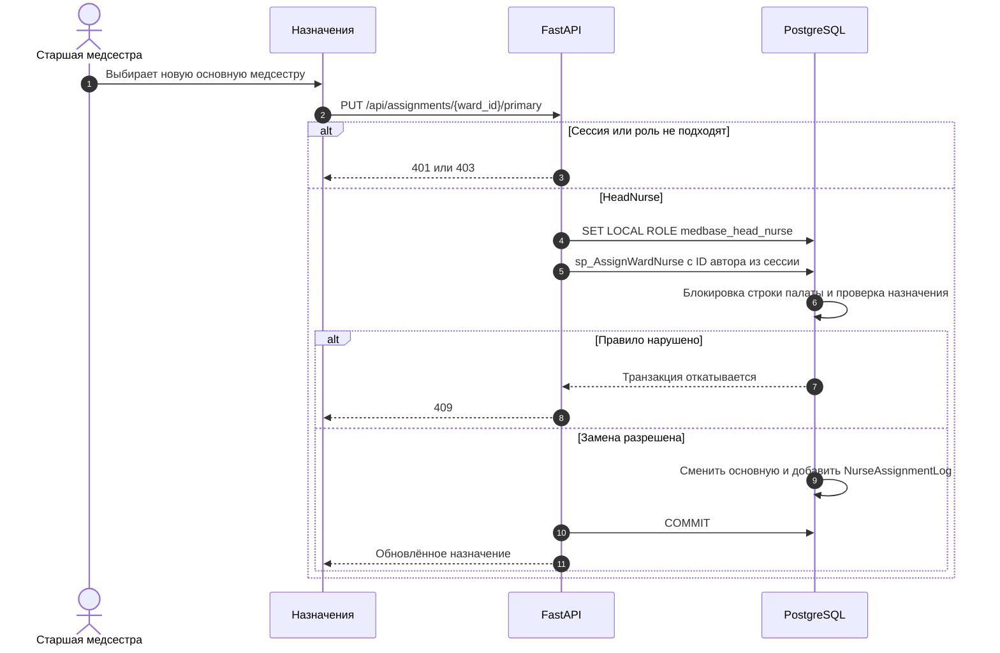
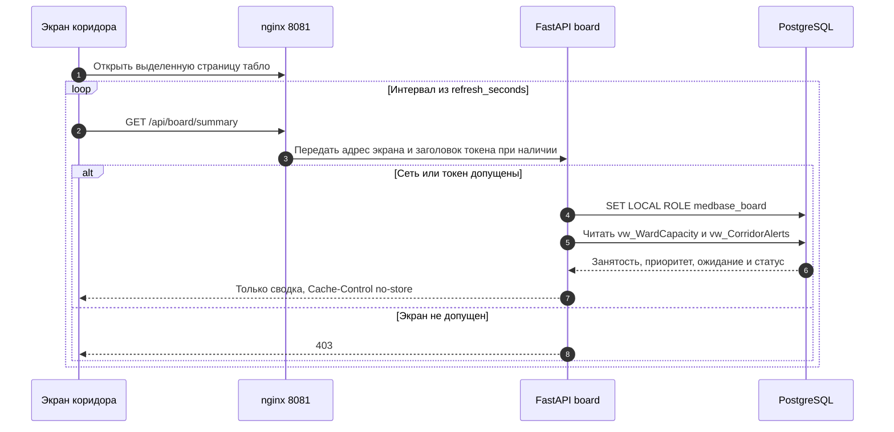
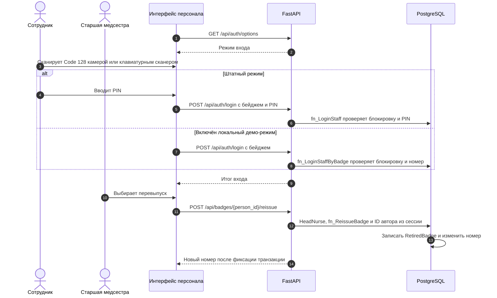

# Sequence diagrams: что делает Hospital Ward Management

Автор: Shynbulat Kazbek (24B032123, Kazbekio), Architecture & Security.

Срез: `main df13eba` от 26 ноября 2026. Первые диаграммы UC-1 — UC-8
созданы на версии от 18 ноября. T-59 обновляет эскалацию и добавляет новые потоки.

Каждая вертикальная линия — участник процесса. Стрелки читаются сверху вниз:
вызов → проверка → изменение данных → ответ. `alt` показывает варианты,
`loop` — повторение. nginx передаёт `/api` в FastAPI без изменения бизнес-логики;
он опущен на диаграммах ради читаемости. SQL-процедуры показаны внутри БД.

Открыть диаграммы можно прямо на GitHub. В VS Code открыть Markdown Preview
(`Ctrl+Shift+V`); если установленная версия preview не рисует Mermaid, показать
этот файл на GitHub. Исходный текст диаграмм хранится вместе с кодом и
обновляется при изменении сценария.

## 1. Вход и разрешение на действие

Реализовано: `backend/app/routers/auth.py`, `auth.py`, `db.py`,
`db/06_login_security.sql`, `db/07_badges.sql`. Сканирование и перевыпуск показаны отдельно в разделе 10.

**Что доказываем:** личность проверяется при входе; роль — при каждом
защищённом действии. Подписанная cookie защищает целостность, но не шифрует
содержимое. `HttpOnly` закрывает доступ из JavaScript страницы; владелец
браузера всё ещё может посмотреть свою cookie в инструментах разработчика.

## 2. Регистрация и госпитализация пациента (UC-1)

Реализовано: `backend/app/routers/admissions.py`, `db/02_procedures.sql`.
Требования FR-01 — FR-04.

**Что доказываем:** новый пациент и его госпитализация сохраняются одной
транзакцией. Проверка свободных мест повторяется после блокировки строки,
чтобы два запроса не заняли последнюю койку одновременно.

## 3. Перевод в другую палату (UC-2)

Реализовано: `admissions.transfer`, `sp_AdmitPatient`. FR-05 — FR-07.

**Что доказываем:** перевод сохраняет историю. Он не меняет номер палаты в
старой записи, а закрывает старую госпитализацию и создаёт новую атомарно.

## 4. Выписка и табло занятости (UC-3, UC-4)

Реализовано: `admissions.discharge`, `wards.list_wards`,
`sp_DischargePatient`, `vw_WardCapacity`. FR-08 — FR-13, NFR-03.

**Что доказываем:** выписанный пациент остаётся в истории, но освобождает
место. Табло считает только активные госпитализации и не раскрывает пациентов.

## 5. Вызов медсестры и подтверждение (UC-5, UC-6)

Реализовано: `routers/simulator.py`, `routers/alerts.py`, `SimulatorPage.tsx`,
`NursePost.tsx`, `sp_RaiseAlert`, `sp_AcknowledgeAlert` и триггер журнала.
FR-14 — FR-22; целевое время показа NFR-01 — не более 2 секунд.

**Что доказываем:** в текущем MVP сигнал создаёт симулятор. Реальные мониторы
и доставка на физические устройства не подключены. Пост использует HTTP-опрос
раз в секунду; SSE здесь пока нет. Сам интервал опроса не доказывает NFR-01:
время до отрисовки и звука нужно отдельно измерять браузерным e2e-тестом.

## 6. Эскалация неподтверждённого сигнала (UC-7)

Реализовано: `backend/app/escalation.py`, `sp_EscalateAlert`.
FR-24 — FR-27; NFR-02 задаёт 30 секунд и допуск до 35 секунд при проверке.

**Что проверяем:** LOW не эскалируется. Процедура повторяет проверку под
блокировкой. При наличии кандидатов после `Available` возможен вызов `Busy`,
в том числе старшей медсестры. Одного сотрудника не зовут дважды на один
сигнал. Ранее вызванные могут подтвердить открытое оповещение на смене.
После исчерпания кандидатов сигнал остаётся у последнего получателя, если он
был назначен. Вызов `OffShift` остаётся планом T-52/T-57. См. решения 12–13.

## 7. Отчёт старшей медсестры (UC-8)

Реализовано: `ReportPage.tsx`, `routers/reports.py`, `vw_AlertResponse`,
`AlertEvent`, роль `medbase_head_nurse`. FR-28 — FR-31.

**Что проверяем:** отчёт только читает данные. Обычная медсестра не может
прочитать отчёт или журнал ни через API, ни непосредственно под своей ролью
PostgreSQL через роль чтения полного журнала. Её роль читает только ограниченный
набор полей `AlertEvent` для отображения прошлых эскалаций. Сводка считает весь
период, история ограничена 500 записями.

## 8. Назначение медсестры на палату (T-51/T-54)

Процедуры удаления и добавления дополнительных медсестёр сохраняют основную.
После коммита новый сигнал учитывает назначения, у существующего сигнала
сохраняется первоначальный получатель. Автоподбор при `OffShift` пишет журнал.

## 9. Коридорное табло без входа (T-55)

Адрес из `X-Real-IP` учитывается только от настроенного доверенного прокси.
При отсутствии ответа больше пяти секунд экран отмечает потерю связи. Метка
`outside_call` относится к эскалации за пределы назначений палаты.

## 10. Сканирование, вход и перевыпуск бейджа (T-53/T-56)

Камере нужен безопасный контекст браузера. При новом входе старый номер
отклоняется. Ранее выданная сессия проверяется отдельно и сохраняет свой срок.

## 11. Связь диаграмм с проверками и направлением разработки

| Сценарий | Существующие проверки | Новый вклад Architecture & Security |
|---|---|---|
| Вход и права | `tests/test_auth.py`, `tests/test_login_lockout.py` | Матрица T-34 охватывает четыре исходные роли. Тесты заявки и бейджей дополняют покрытие |
| UC-1 — UC-3 | `tests/test_admissions.py`, SQL-тесты процедур | Запрет чтения, госпитализации, перевода и выписки чужим ролям; отсутствие изменений при отказе |
| UC-4 | `tests/test_admissions.py` | Точный список полей табло без персональных данных |
| UC-5, UC-6 | `tests/test_alerts.py` | Доступ к симулятору и посту; чужая палата; выключенный симулятор |
| UC-7 | `tests/test_alerts.py`, `tests/test_escalation.py`, SQL-тесты | Схема worker, защита транзакции, доставка предыдущим получателям. Замеры T-29 относятся к версии до PR #25/#27 |
| UC-8 | `tests/test_reports.py`, SQL-тесты прав | Endpoints отчёта и журнала в матрице: только HeadNurse; отчёт и журнал закрыты в PostgreSQL для остальных ролей |
| Назначения | `tests/test_assignments_api.py`, `tests/test_assignment_alerts.py`, SQL | Роль HeadNurse, журнал, смена основной и разделение существующих и новых сигналов |
| Табло | `tests/test_board.py`, `frontend/e2e/corridor-board.spec.ts` | Граница сети, выделенный порт и минимальная сводка |
| Бейджи | `tests/test_badges.py` | Права печати и перевыпуска, обязательность PIN по умолчанию и отклонение старого номера |

Реализация движется к согласованным двум процессам: UC-1 — UC-8 связаны
API и UI. Диаграммы помогают проверить,
что новый код сохраняет транзакции, историю и оба слоя контроля доступа.
Зелёные тесты прав подтверждают этот аспект, но не заменяют приёмку всех
сценариев, измерение задержек, тест звука и полную проверку безопасности.

Отчёты: [права API](testing/api-permissions-report.md), [замеры T-29](testing/alert-timing-report.md),
[ревью T-50/T-59](reviews/t50-t59-security-review.md).
